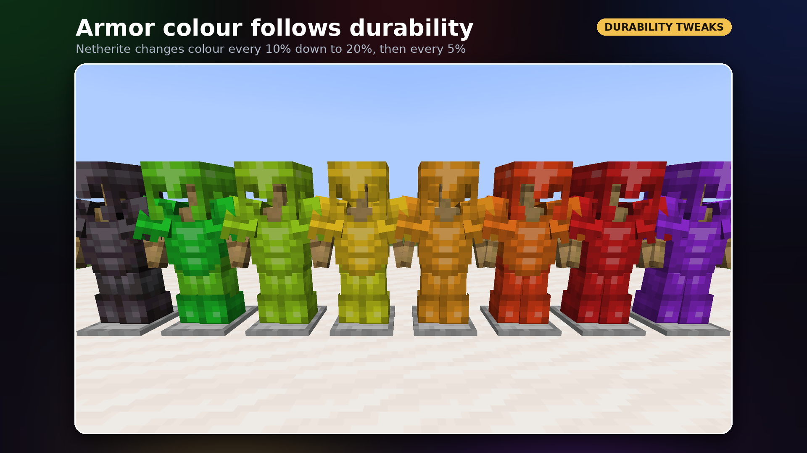
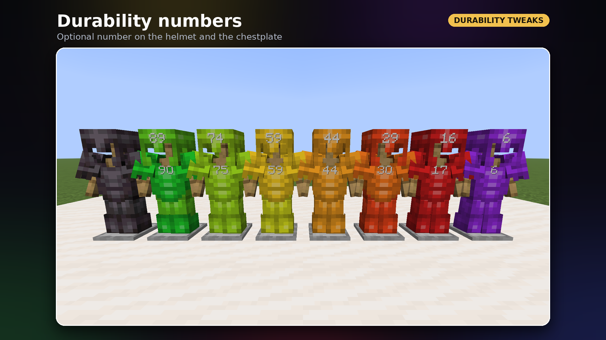
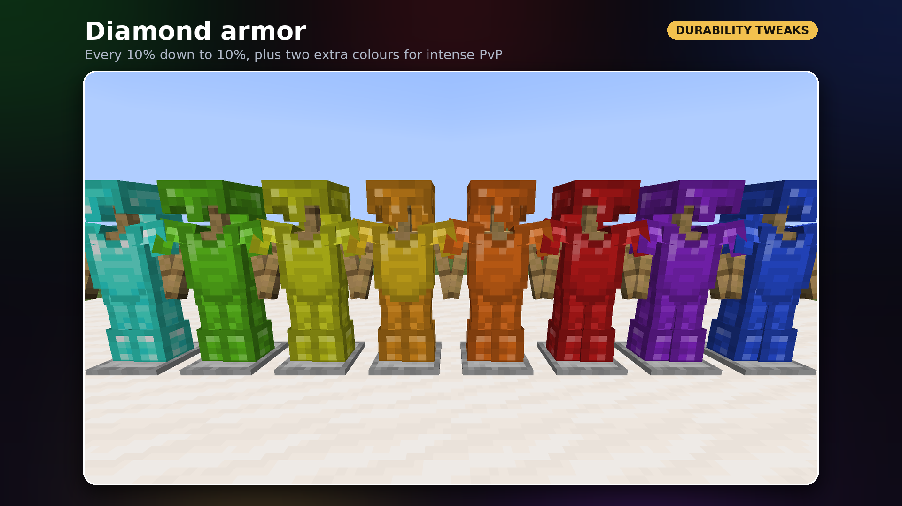
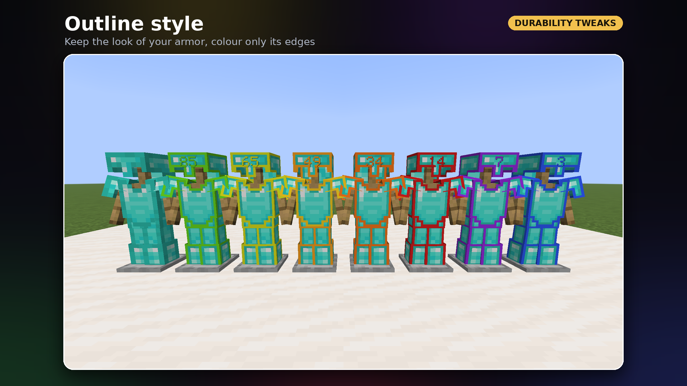
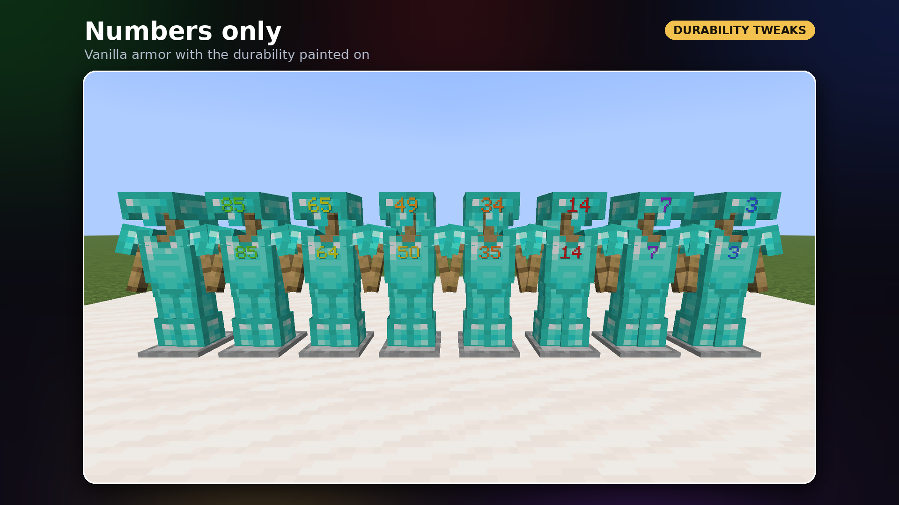
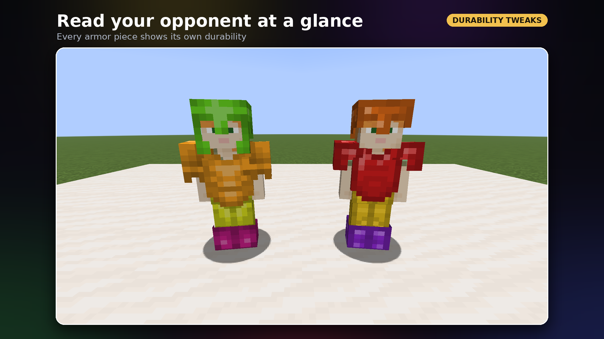
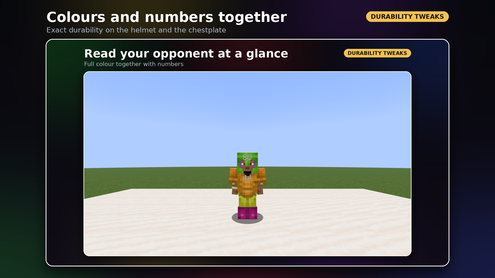
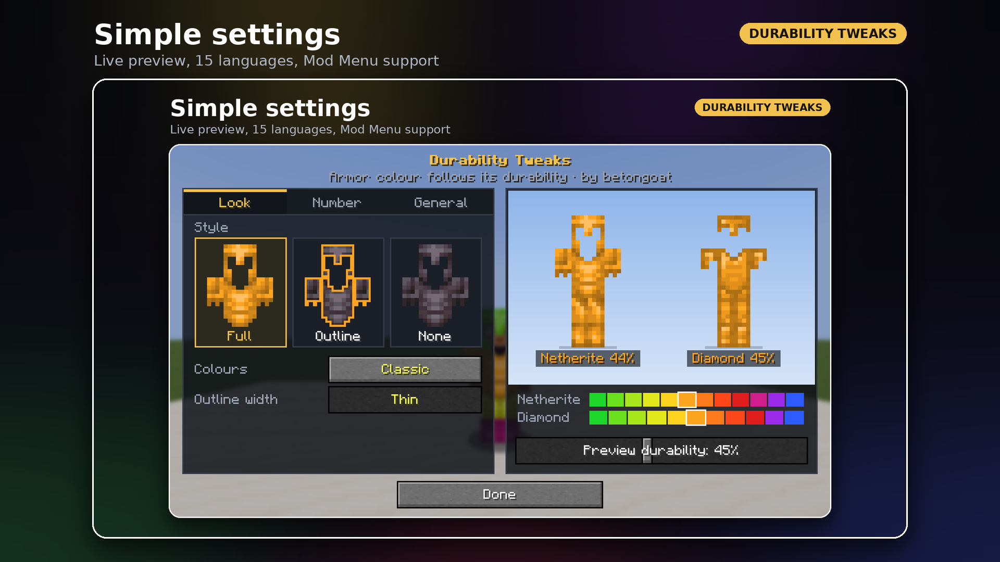

# Durability Tweaks

Mod kliencki na **Fabric**, który działa jak *dura pack*: zbroja zmienia kolor w miarę utraty wytrzymałości.
Pełna (nieuszkodzona) zbroja wygląda zupełnie zwyczajnie.

Autor: **betongoat** · Licencja: MIT

## Galeria

Zrzuty ekranu z gry robione automatycznie przez CI (Minecraft 1.21.11, 1920×1080):

| | |
|---|---|
|  |  |
|  |  |
|  |  |
|  |  |

## Wersje

**Jeden plik `durabilitytweaks-1.0.0.jar` działa na wszystkich wersjach 1.21 – 26.3.** W środku są wersje
dla poszczególnych grup wydań Minecrafta, a Fabric Loader sam ładuje tę pasującą do gry:

| Wersja w środku | Minecraft       | Java |
|-----------------|-----------------|------|
| `+1.21.1`  | 1.21 – 1.21.1        | 21   |
| `+1.21.3`  | 1.21.2 – 1.21.3      | 21   |
| `+1.21.4`  | 1.21.4               | 21   |
| `+1.21.5`  | 1.21.5               | 21   |
| `+1.21.8`  | 1.21.6 – 1.21.8      | 21   |
| `+1.21.10` | 1.21.9 – 1.21.10     | 21   |
| `+1.21.11` | 1.21.11              | 21   |
| `+26.1.2`  | 26.1 – 26.1.2        | 25   |
| `+26.2`    | 26.2                 | 25   |
| `+26.3`    | 26.3                 | 25   |

Wymagane: Fabric Loader i Fabric API. Opcjonalnie: [Mod Menu](https://modrinth.com/mod/modmenu) (przycisk konfiguracji na liście modów).

## Jak zmienia się kolor

**Netheryt** – od 100% do 20% kolor zmienia się co 10% uszkodzenia, od 20% co 5%.

**Diament** (i domyślnie każda inna zbroja) – co 10% od 100% do 10%, plus 2 dodatkowe kolory na intensywne PvP:
od 10% kolor zmienia się co 5%.

| Wytrzymałość | Netheryt | Diament |
|--------------|----------|---------|
| 100%         | zwykła zbroja | zwykła zbroja |
| 90–99%       | zielony | zielony |
| 80–89%       | jasnozielony | jasnozielony |
| 70–79%       | limonkowy | limonkowy |
| 60–69%       | żółtozielony | żółtozielony |
| 50–59%       | żółty | żółty |
| 40–49%       | bursztynowy | bursztynowy |
| 30–39%       | pomarańczowy | pomarańczowy |
| 20–29%       | czerwono-pomarańczowy | czerwono-pomarańczowy |
| 15–19%       | czerwony | czerwony (10–19%) |
| 10–14%       | magenta | ↑ |
| 5–9%         | fioletowy | fioletowy |
| 0–4%         | niebieski | niebieski |

## Ustawienia (GUI)

Otwierane klawiszem **K** (do zmiany w Sterowaniu) albo przyciskiem w Mod Menu.
Domyślnie: pełne kolory, bez liczby. Po lewej opcje w trzech zakładkach, po prawej podgląd na żywo
zbroi netherytowej i diamentowej z suwakiem wytrzymałości oraz skala kolorów
(najedź na kolor, żeby zobaczyć zakres procentów).

- **Wygląd** – styl do wyboru na obrazkach: *Pełny* (cała zbroja, jak klasyczny dura pack),
  *Obramówka* (zbroja wygląda normalnie, kolorowe są tylko krawędzie), *Brak*;
  kolory (klasyczne, zielony → czerwony, dla daltonistów); grubość obramówki.
- **Liczba** – brak / na hełmie / na hełmie i napierśniku; procenty albo punkty; czy pokazywać przy 100%.
- **Ogólne** – włącz/wyłącz, które zbroje (wszystkie albo diament i netheryt), reset.

Języki: angielski, polski, niemiecki, hiszpański, francuski, portugalski (BR), rosyjski, ukraiński,
czeski, włoski, turecki, holenderski, chiński, japoński, koreański.

## Serwery

Mod działa tylko po stronie klienta: nie wysyła żadnych pakietów i niczego nie rejestruje, więc serwer go
nie widzi i nie musi go mieć. Dodatkowo mod blokuje znaną sztuczkę wykrywania modów przez tabliczki
(serwer wpisuje klucz tłumaczenia moda na tabliczkę i patrzy, co klient odeśle) – dla serwera klient
wygląda wtedy jak zwykły.

Ustawienia zapisują się w `config/durabilitytweaks.json`.

## Jak to działa

Mod nie zawiera żadnych tekstur. Kolorowe wersje są generowane w locie z tekstur aktywnego resource packa
(więc działa też z customowymi packami i zbrojami z innych modów) i podmieniane podczas renderowania zbroi –
na graczach, mobach i stojakach na zbroję. Nieużywane tekstury są zwalniane automatycznie,
a po przeładowaniu resource packów (F3+T) wszystko generuje się od nowa.

## Budowanie

Projekt używa [Stonecutter](https://stonecutter.kikugie.dev/) do budowania wielu wersji z jednego kodu.

```sh
./gradlew universalJar             # jeden jar na wszystkie wersje -> build/libs/durabilitytweaks-<wersja>.jar
./gradlew buildAndCollect          # osobne jary -> build/libs/<wersja moda>/
./gradlew :1.21.11:runClientGameTest # test w grze + zrzuty do galerii
```

Potrzebne JDK 21 i JDK 25. GitHub Actions buduje każdą wersję i udostępnia gotowe jary jako artefakty.
